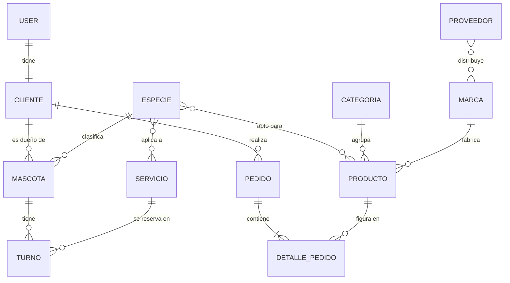

# Mateo Pet Shop — API

API REST de **Mateo Pet Shop**, tienda de alimentos balanceados, accesorios y servicios de estética para mascotas. Expone el catálogo de productos, la gestión de mascotas de cada cliente, la reserva de turnos de peluquería y los pedidos.

## Objetivo

Centralizar la operación del pet shop: catálogo con stock, clientes y sus mascotas, turnos de servicios y pedidos. La API es consumida por el frontend en Next.js (Programación III).

## Planificación de la base de datos

### Entidades

| Modelo | App | Descripción |
| --- | --- | --- |
| Especie | catalogo | Perro, gato, ave, pez, etc. |
| Categoria | catalogo | Alimentos, accesorios, higiene, juguetes |
| Marca | catalogo | Fabricante del producto |
| Proveedor | catalogo | Distribuidor; trabaja varias marcas |
| Producto | catalogo | Artículo a la venta, con precio y stock |
| Servicio | catalogo | Baño, corte, vacunación; con precio y duración |
| Cliente | clientes | Perfil del usuario (teléfono, dirección) |
| Mascota | clientes | Animal de un cliente |
| Turno | clientes | Reserva de un servicio para una mascota |
| Pedido | ventas | Compra de un cliente |
| DetallePedido | ventas | Línea de un pedido (producto, cantidad, precio) |

### Diagrama entidad-relación

### Decisiones de diseño

- `DetallePedido.precio_unitario` guarda el precio al momento de la compra, para que un pedido viejo no cambie si sube el producto.
- `Cliente` es un perfil uno a uno con el `User` de Django; se crea automáticamente al registrar un usuario.
- Productos y servicios se relacionan con `Especie` (muchos a muchos) para filtrar, por ejemplo, "alimento para gatos" o validar que un servicio aplique a la mascota.

## Tecnologías

Python 3.12 · Django · Django REST Framework · PostgreSQL · uv · Docker